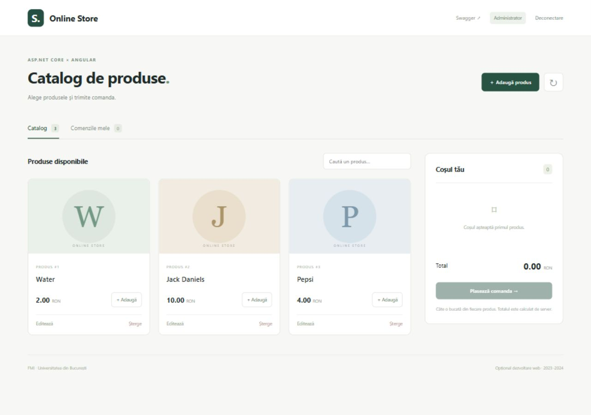

# Online Store — .NET & Angular

Proiect pentru opționalul **Dezvoltarea aplicațiilor web în .NET**, anul universitar **2023–2024**, Facultatea de Matematică și Informatică, Universitatea din București.

Magazin demonstrativ cu autentificare, roluri de client/administrator, produse, coș și comenzi. Proiectul inițial folosea .NET 7, SQL Server Express și Angular 17. Versiunea actuală păstrează funcționalitățile și API-ul, actualizează runtime-ul la **.NET 10 LTS** și interfața la **Angular 20**, adăugând o bază SQLite pentru pornire locală simplă și un showcase separat pentru GitHub Pages.

## Showcase online

**[Deschide demo-ul pe GitHub Pages](https://andreiasm5.github.io/PROIECT_OPT_DEZV_APL_WEB_2023_2024/)**

Demo-ul public folosește numai browserul: produsele și comenzile sunt salvate local, iar rolurile client/administrator sunt simulate și indicate explicit în interfață. Nu există autentificare reală sau transmitere de parole pe GitHub Pages. Poți adăuga produse în coș, crea/modifica/șterge comenzi și comuta în modul administrator pentru CRUD de produse.

Versiunea locală folosește API-ul ASP.NET Core, ASP.NET Core Identity, tokenuri JWT și Entity Framework Core. Configurațiile Angular de producție și dezvoltare folosesc API-ul real; numai configurația pages activează simularea în browser.

## Pornire locală

Necesare: **SDK .NET 10** și **Node.js 24**. Nu este necesar SQL Server pentru configurația implicită.

~~~powershell
cd Backend
$env:ASPNETCORE_ENVIRONMENT='Development'
dotnet run --launch-profile http
~~~

Într-un al doilea terminal:

~~~powershell
cd Frontend
npm ci
npm start
~~~

| Componentă | Adresă |
| --- | --- |
| Angular | http://localhost:4300 |
| Swagger | http://localhost:5156/swagger/index.html |
| Verificare API | http://localhost:5156/api/health |

Pe Windows se pot folosi și Start-Demo.ps1 / Stop-Demo.ps1, din rădăcina proiectului:

~~~powershell
powershell -ExecutionPolicy Bypass -File .\Start-Demo.ps1
powershell -ExecutionPolicy Bypass -File .\Stop-Demo.ps1
~~~

Pe calculatorul unde a fost pregătit proiectul, fișierul local ignorat .runtime/runtime.json indică SDK-ul portabil. Pe alt calculator, scriptul folosește dotnet din PATH. Parametrul -SkipBuild repornește un build existent. Logurile sunt în run-logs/.

### Conturi pentru demonstrația locală

| Rol | Email | Parolă demonstrativă |
| --- | --- | --- |
| Administrator | admin@example.com | DemoAdmin123! |
| Client | customer@example.com | DemoCustomer123! |

Aceste conturi sunt create numai în mediul Development. Poți folosi butoanele rapide din pagina de autentificare sau poți înregistra un client nou. Utilizatorii înregistrați primesc rolul User; crearea altor administratori este permisă numai unui administrator autentificat.

### Baza de date și configurarea JWT

SQLite folosește fișierul Backend/data/store.db, creat automat la prima pornire în Development, împreună cu cele trei produse originale: Water, Jack Daniels, Pepsi. Oprirea aplicației păstrează datele.

SQL Server rămâne disponibil prin configurare: setează DatabaseProvider=SqlServer și ConnectionStrings__DefaultConnection cu șirul bazei tale. Folosește o bază nouă; proiectul nu include o migrare automată a unei baze SQL Server vechi. Baza SQLite locală este separată.

Secretul JWT din vechea configurație a fost eliminat. În Development se generează o cheie la fiecare pornire, astfel încât autentificările anterioare expiră la repornirea serverului. În alte medii trebuie setat JWT__Secret (minimum 32 de octeți), iar crearea bazei și a rolurilor trebuie administrată explicit. Datele, cheile și configurația portabilă locală sunt ignorate de Git.

## Docker Compose

Opțional, cu Docker configurat pentru containere Linux:

~~~bash
docker compose up --build -d
docker compose logs -f
docker compose down
~~~

Interfața este pe portul 4300 și backendul pe 5156. SQLite este păstrat în volumul store-data, deci nu există un serviciu separat pentru baza de date. Containerul API folosește Development și conturile demonstrative de mai sus; porturile sunt publicate numai local. La prima pornire, inițializarea backendului poate dura câteva secunde.

## API și reguli

- POST /api/login, POST /api/register: autentificare și înregistrare client.
- POST /api/register-admin: înregistrare administrator, acces numai Admin.
- GET /api/product/all și GET /api/product/{id}: produse pentru utilizatorii autentificați.
- POST /api/product, PUT/DELETE /api/product/{id}: CRUD pentru Admin.
- GET /api/order/all: comenzile utilizatorului curent.
- GET /api/order/{id}: comandă proprie; administratorul poate consulta și alte comenzi.
- POST /api/order și PUT/DELETE /api/order/{id}: creare și modificări numai în comenzile proprii.

O comandă conține între 1 și 100 de produse distincte, câte o bucată din fiecare. Totalul este calculat de server și nu este preluat din cererea clientului. Actualizarea comenzii recalculează totalul; totalul deja salvat rămâne un instantaneu dacă prețul unui produs este modificat ulterior. Produsele folosite în comenzi nu pot fi șterse. Prețurile acceptă maximum două zecimale.

## Verificări

~~~powershell
dotnet build Backend/Backend.csproj
cd Frontend
npm ci
npm test
npm run build
~~~

Cu backendul Development pornit, din rădăcina proiectului:

~~~bash
node scripts/smoke-test.mjs
~~~

Verificarea HTTP acoperă **32 de aserțiuni**: autentificare, roluri, înregistrare, CRUD, validare, calculul totalului, izolarea comenzilor între utilizatori și Swagger. Creează un client temporar și produse/comenzi de test; comenzile și produsele temporare sunt șterse la final, iar contul de test rămâne în baza locală. Folosește o bază dedicată testării dacă dorești separare completă. API_URL permite verificarea prin proxy-ul Angular, de exemplu http://127.0.0.1:4300.

Frontendul are **6 teste automate** pentru stocarea și regulile showcase-ului: persistență, CRUD, calculul comenzilor, referințe la produse, validare și erori de stocare.

## Actualizarea GitHub Pages

~~~bash
cd Frontend
npm ci
npm test
npm run build:pages
~~~

Comanda pregătește aplicația în docs/, cu baza URL a repository-ului. Publică sursele și docs/ pe main; GitHub Pages servește acest director. Showcase-ul nu depinde de pornirea calculatorului local.

## Verificarea proiectului inițial

Sursa originală .NET 7 s-a compilat, iar Swagger a răspuns cu 200. Autentificarea a răspuns cu 500 deoarece instanța SQL Server Express configurată nu exista pe calculator. Au fost remediate pornirea locală, rolurile conturilor, erorile 400/404/409, lipsa claim-ului de identitate folosit în frontend și încrederea în totalul primit de la client.

Instrucțiunile vechi recomandau generarea unei migrări EF, dar repository-ul nu conținea migrări. Configurația Development actuală folosește EnsureCreated pentru o bază nouă; nu înlocuiește un sistem de migrări pentru o aplicație de producție.

Implementarea inițială de autentificare a fost inspirată de articolul [JWT Authentication and Authorization in .NET 6.0 with Identity Framework](https://www.c-sharpcorner.com/article/jwt-authentication-and-authorization-in-net-6-0-with-identity-framework/), credit păstrat din README-ul original.

Configurația Docker Compose a fost validată structural; imaginile nu au fost executate pe acest calculator, unde Docker Desktop nu este instalat.
